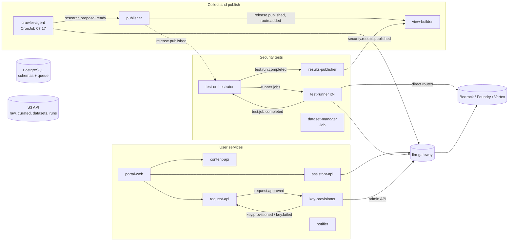

# Architecture (v2)

Design doc for humans: "LLMOps 平台架構 v2：元件拆分與地端部署" (2026-10-31). This page is the engineering summary.

## Principles

1. **Everything but the models runs on our Kubernetes.** The AWS test box and on-prem run the same images.
2. **Four standard interfaces only:** PostgreSQL, S3 API, OIDC, OpenAI-compatible gateway. Changing environment
   means changing environment variables, never code.
3. **One component, one image, one job.** 15 components, each deployable and scalable on its own, each with only
   the credentials it needs.
4. **No component calls another.** They hand work over through events (PostgreSQL queue) and files (object
   storage). The one exception: portal-web forwards `/api/*` to the services behind it.
5. **Models only through the gateway** (LiteLLM), except test-runner's direct routes, which test the clouds'
   own endpoints on purpose.

## Components and flows

| Flow | What happens |
|---|---|
| Collect and publish | crawler-agent reads official sources (FQDN allowlist), writes a proposal to `curated/research/`, publishes `research.proposal.ready`. publisher validates it, applies the release gates, writes `portal/releases/{id}/`, moves the pointer and publishes `release.published` (and `route.added` for new model routes). view-builder merges the release, editorial content, the security matrix and the latest security results into `portal/views/{id}/portal.json`. |
| User services | portal-web serves the page and forwards API calls. content-api serves the current view. assistant-api answers 問問看 and helps with the request form through the gateway. request-api stores requests, computes the gates (G0, G2, G8, G9), handles review and keeps the audit trail. On approval, key-provisioner creates a virtual key in the gateway and stores it in the secret store. notifier sends e-mail or chat messages for the events people care about. |
| Security tests | dataset-manager imports and approves one dataset version per SEC item. test-orchestrator plans a run when a route is added, the gateway version changes or an admin asks, and enqueues one job per route and batch of items. test-runner executes jobs (judge through the gateway), writes case-level lines and summaries to `runs/`. results-publisher turns a finished run into the portal's security data and the G6 status. |

Contracts: [events](../contracts/events.md), [storage layout](../contracts/storage-layout.md),
[test jobs](../contracts/test-jobs.md), [DB migrations](../contracts/db/migrations/),
[request schema](../contracts/schemas/request.schema.json), [SEC catalog](../contracts/sec-catalog.json).

## Events and work queue

Publishing an event inserts a row in `platform.events` and one job per subscriber in `platform.jobs`, in the same
transaction as the change that caused it. Workers claim jobs with `FOR UPDATE SKIP LOCKED` and a lease; a job
that keeps failing backs off exponentially and ends as `dead` for a person to inspect. A worker killed mid-job
loses nothing: the lease expires and another worker takes the job. The subscription table lives in
`llmops_common.queue.SUBSCRIPTIONS`. PostgreSQL is enough at this volume (dozens of events a day, thousands of
test jobs per run); Kafka or NATS can replace it behind the same `publish` / `Worker` interface if that changes.

## HTTP API

| Path (through portal-web) | Service |
|---|---|
| `/api/content/*` | content-api |
| `/api/chat`, `/api/assist/form` | assistant-api |
| `/api/requests*` | request-api |
| `/api/tests/*` | test-orchestrator (admin) |

Every service checks the OIDC token itself (`AUTH_MODE=oidc`) and maps IdP groups to roles with `ROLE_<NAME>`
variables. Test environments use `AUTH_MODE=dev`.

## Identities

| Who | How |
|---|---|
| People | company IdP (OIDC); portal-web behind the cluster's login (oauth2-proxy or ingress auth); services verify the token |
| Components → PostgreSQL / S3 | per-component credentials from Secrets (test: generated; on-prem: Vault or cluster Secrets) |
| Components → models | one gateway virtual key each, limited to its model aliases, with a budget |
| llm-gateway, test-runner → clouds | X.509 certificate from the company CA exchanged for short-lived credentials: IAM Roles Anywhere (AWS), Entra certificate credentials (Azure), workload identity federation (GCP) |

## Environments

| | On-prem (production) | AWS test | Local |
|---|---|---|---|
| Platform | company Kubernetes | one EC2, k3s | Docker Compose or local k3s |
| Images | internal registry | ECR | local build |
| PostgreSQL / S3 | company services | in-cluster (test-infra) | containers |
| Login | company IdP | dev mode, SSM tunnel only | dev mode |
| Outbound | forward proxy + FQDN allowlist | direct | direct |
| Models | three clouds through the gateway | Bedrock | mock-llm |

## Not built yet

- RAG, agent, MCP and browser test targets (phase 3), each a separate component.
- A sandboxed runner for SEC-15, 22 and 27 (gVisor or Kata if the cluster offers it, otherwise a separate VM).
- Metrics endpoints for Prometheus (logs are structured JSON today).
